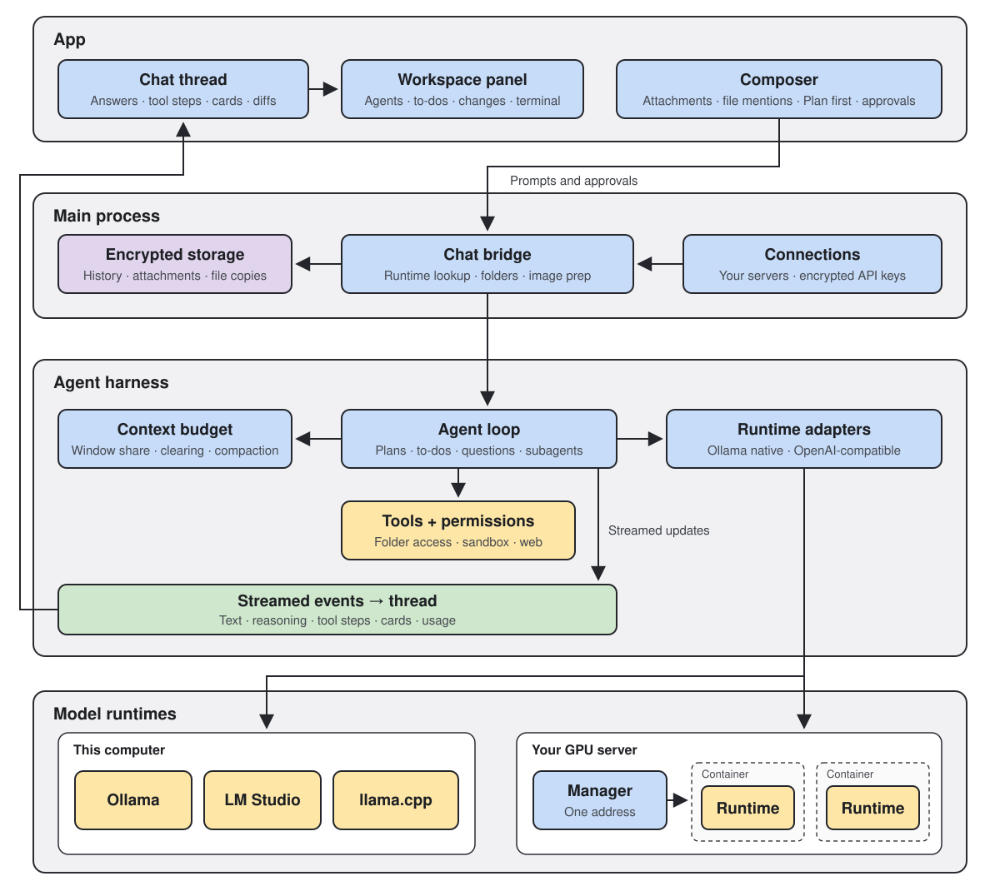

<p align="center">
  
</p>

<h1 align="center">ENDURANCE</h1>
<p align="center">A private chat workspace and harness for your own models.</p>

<p align="center">
  &nbsp;
  &nbsp;
  &nbsp;
  &nbsp;
  &nbsp;
  &nbsp;
  &nbsp;
</p>

ENDURANCE is a desktop chat app for AI models you run yourself. Connect Ollama, LM Studio, llama.cpp, vLLM or another compatible runtime, on your computer or on a server you operate, and let your models work in project folders, use tools and search the web. Chats and projects stay on your computer, encrypted.

<p align="center">
  
</p>

## What it does

- **Chat with your own models.** Use a runtime on this computer or on any server you can reach, and pick the model per chat.
- **Models.** Set each model's name, context length, thinking and sampling.
- **Projects.** Organize chats around the folders they work in. Every chat in a project shares its folders, instructions and permissions.
- **Agent.** Works directly in your project, from code exploration to test runs, with every change tracked as a reviewable, reversible diff.
- **Plans and to-dos.** The agent proposes a plan for you to approve and keeps a to-do list as it works. Turn on Plan first to make it plan before changing anything.
- **Questions.** When a decision is yours to make, the agent asks and offers options, as single or multiple choice.
- **Subagents.** Large tasks are split among subagents, each working in a fresh context. Explorers only read, and workers change only the files they are given.
- **Skills.** Add skill folders in Library; the agent uses one when a request matches it, or when you name it.
- **Web.** With Internet Access on, the model searches the web, reads pages and cites its sources.
- **Attachments.** Images, PDF, Word, Excel, CSV and text files. Scanned pages are read by a vision model you choose, even when the chat model reads only text.
- **Long chats.** A context meter shows how full the model's window is. Older messages are summarized once a chat outgrows it.
- **Your own GPU server.** Deploy the Endurance server manager on your GPU machine and connect it to Endurance. It serves every vLLM model on the machine through one address, at the context length you choose. See `server/README.md`.

## Security

- **Encrypted history.** Chats and projects are stored encrypted on your computer, with the key in your system keychain.
- **Project access.** In Project settings, set each folder, subfolder or file to Read & write, Read only or No access, and manage the commands the agent may run without asking in one list.
- **Approvals and Internet Access.** Each chat sets how much the agent does without asking, from Ask for approval to Approve for me or Full access. Internet Access turns the web on or off.
- **Sandboxed commands.** Commands run inside your project folders and can change files only where you allowed writing.
- **Secrets stay closed.** Files such as `.env` and private keys can be listed but never opened or changed.
- **Content is labelled by source.** Notes the app adds to a chat carry the app's mark, which text from files, web pages or tools cannot carry.

## Install

There are no prebuilt downloads yet. Build the app on your Mac:

1. Install [Node 24 LTS](https://nodejs.org) (npm comes with it) and Git.
2. Build the app:

   ```sh
   git clone https://github.com/stellarsteader/endurance.git
   cd endurance
   npm ci
   npm run package:mac:dir -- --arm64
   ```

   On an Intel Mac, use `--x64` instead of `--arm64`.
3. Open `release/mac-arm64/Endurance.app` (Intel: `release/mac/Endurance.app`). Drag it to Applications to keep it. From then on the app runs without a terminal or Node.
4. Start a model runtime such as Ollama or LM Studio. Endurance finds runtimes on this computer by itself; connect any other server with **Add server**.

Your chats, projects, settings and connections are kept in `~/Library/Application Support/Endurance` on your Mac.

### Opening a downloaded build

Builds are not signed or notarized by Apple. An app you built yourself opens normally. A copy downloaded from GitHub Actions or shared by someone else is blocked on first launch:

1. Open Endurance once and close the warning.
2. Open **System Settings → Privacy & Security**, find the message that Endurance was blocked, click **Open Anyway** and confirm.

If macOS instead says the app "is damaged and can't be opened", remove the download flag from a copy you trust, then open it again:

```sh
xattr -dr com.apple.quarantine /Applications/Endurance.app
```

On Windows, SmartScreen asks first: choose **More info → Run anyway**. Windows and Linux builds have not been tested on real installations yet.

### Signing your own builds

`npm run package:mac:dir` gives each build a new throwaway signature, so macOS treats every rebuild as a different app: it asks again before Endurance can read its history key ("Endurance Safe Storage" in the Keychain) and again for the microphone. To keep one identity across rebuilds, sign with a certificate from your login keychain:

```sh
ENDURANCE_SIGNING_IDENTITY="Apple Development" npm run package:mac:local -- --arm64
```

`package:mac:local` builds the same app as `package:mac:dir`, signed with `ENDURANCE_SIGNING_IDENTITY` (default `Endurance Local Signing`). It stops with an error if that certificate is missing, and skips Apple's timestamp and notarization. Pick a certificate:

- **Apple Development** (recommended; a free Apple ID is enough). In Xcode, open **Settings → Accounts**, add your Apple ID, then **Manage Certificates → + → Apple Development**. If you have more than one, set the variable to the full name shown by `security find-identity -v -p codesigning`. macOS asks once more for the Keychain after you switch, and not again on later rebuilds.
- **Self-signed**, without an Apple ID. Run `sh scripts/create-signing-identity.sh` once and trust the certificate as it explains, then run `npm run package:mac:local -- --arm64`. The first build may ask whether `codesign` may use the new key. This keeps the microphone permission across rebuilds, but the Keychain still asks after each rebuild: macOS ties Keychain access to an Apple-issued Team ID, which a self-signed certificate does not have.

`npm run dev` and the other package scripts are not affected, and CI and release builds stay unsigned. Both kinds of certificate are for builds on your own Mac. A copy for other people needs a Developer ID Application certificate from the paid Apple Developer Program, plus notarization.

## Development

Use Node 24 LTS (`.nvmrc`) and npm.

```sh
npm ci
npm run dev
```

`npm run dev` updates UI changes in place and restarts the app when main-process or worker code changes. A restart stops a reply in progress. It uses its own profile, `~/Library/Application Support/Endurance Dev`, and its history key is "Endurance Dev Safe Storage" in the Keychain. macOS asks for that key until you choose **Always Allow**, and again after the repo moves or Electron is reinstalled.

| Work | Command |
| --- | --- |
| Desktop app with live reload | `npm run dev` |
| Production build | `npm run build` then `npm start` |

## Checks

```sh
npm run check        # types and lint
npm run build
npm run test:desktop # smoke tests of the built app
```

The smoke tests drive the built app against a local stand-in server, not a real model, with their own throwaway profiles.

`scripts/fixtures/workspace/` holds sample project folders for trying projects and folder access by hand, including a `private/` folder for No access. Copy it somewhere else first, since an agent with write access changes the files.

## License

Endurance is licensed under the [PolyForm Noncommercial License 1.0.0](LICENSE). You may use, modify and share it for noncommercial purposes; commercial use needs a separate license from the copyright holder. Code in `src/harness/vendor`, and the parts of other files marked as derived from it, remain under the [MIT License](src/harness/vendor/LICENSE).
